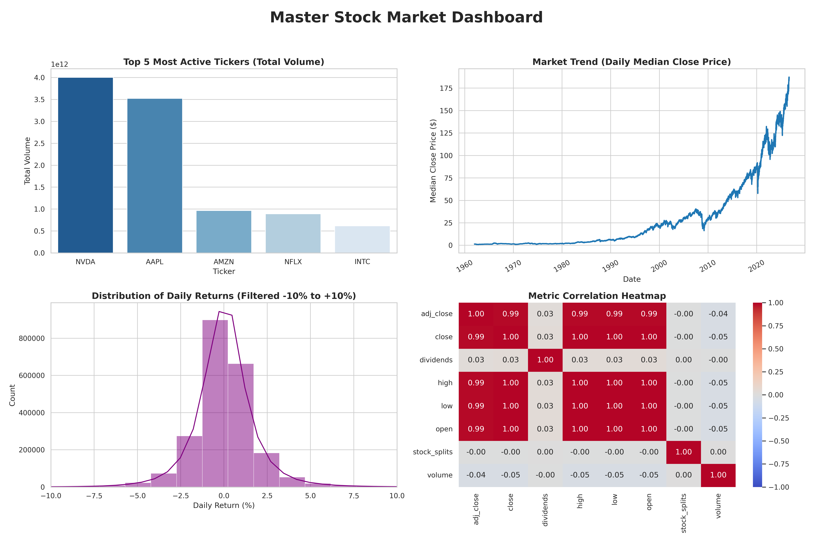

# Python Data Profiling, Cleaning & Exploratory Dashboard

A Google Colab / Python project that explores and prepares a large multi-ticker stock-market dataset, then generates a visual summary dashboard. The notebook uses pandas and NumPy for data preparation and Matplotlib/Seaborn for exploratory visualisation.

Workflow overview

1. Load the source CSV.
2. Generate an HTML data-profiling report.
3. Remove duplicate rows and standardise column names.
4. Remove columns with more than 60% missing values.
5. Impute remaining numeric missing values with column medians and text missing values with `unknown`.
6. Export a cleaned CSV and a 2×2 exploratory dashboard.

## Project scale

The documented dataset contains **2,219,678 rows and 10 columns**, covering 233 ticker symbols and 16,274 distinct dates.

The repository includes:
- [Jupyter notebook](ProfileReport_DataCleaning_Dashboard.ipynb)
- [Cleaned-data observations](Cleaned%20Data%20Insight.md)
- [Dashboard image](dashboard.png)
- [Raw profiling report](raw_profile.html)

## Tools and libraries

- Python
- pandas and NumPy
- Matplotlib and Seaborn
- `fg-data-profiling`
- Google Colab / Jupyter Notebook

## Data preparation approach

The notebook applies the following steps:

- Removes exact duplicate rows.
- Standardises column names to lowercase with underscores.
- Drops columns where more than 60% of values are missing.
- Fills missing numeric values with the column median.
- Fills missing text values with `unknown`.
- Exports the resulting dataset to `cleaned_data.csv`.

The notebook then builds a generic 2×2 exploratory dashboard using available columns: a numeric distribution, a date trend or category-frequency chart, a relationship plot and a numeric correlation heatmap. The relationship plot samples up to 50,000 rows to keep plotting manageable.

## Running the notebook

1. Open [Google Colab](https://colab.research.google.com/).
2. Open the repository notebook: `ProfileReport_DataCleaning_Dashboard.ipynb`.
3. Install the profiling dependency by running the first notebook cell.
4. Make the source CSV available in your Google Drive at the path expected by the notebook:
   `/content/drive/MyDrive/master_stock_data.csv`.
5. If your file is stored elsewhere, update the path in the data-loading cell before running the notebook.
6. Run the cells in order. The notebook exports the HTML profile, cleaned CSV and dashboard image.

**Important:** The source CSV is not included in this repository. The notebook currently expects a Google Drive file at the path above; it does not automatically upload an arbitrary CSV. In a fresh Colab session, mount Google Drive before reading the file.

## Initial observations from the dataset

The accompanying insight note reports strongly right-skewed distributions for several price and volume fields. For example, the reported mean adjusted close is 52.64 compared with a median of 17.58, while volume has a reported mean of approximately 10.88 million and a median of approximately 2.58 million.

These are descriptive statistics from the documented dataset, not investment recommendations or predictions.

## Analytical considerations and limitations

- **Median imputation:** Filling missing values with a median is a practical baseline, but it changes the distribution. For financial time-series data, missingness should be investigated before imputation; a missing observation may have a meaningful cause.
- **Duplicate removal:** Exact duplicate removal is useful, but the business key and expected uniqueness of ticker/date records should also be checked.
- **Date handling:** The notebook attempts to identify date-like columns by their names. Other date formats or differently named columns may need explicit parsing.
- **Generic visualisations:** The dashboard chooses columns based on data types and column order. The charts are exploratory and should be reviewed for analytical relevance before drawing conclusions.
- **Data validation:** The workflow does not yet include a full set of domain checks for impossible prices, zero-volume records, corporate actions or ticker/date uniqueness.

## Future improvements

1. Add a configurable file-upload or file-path input instead of relying on a fixed Drive path.
2. Parse and validate dates and ticker/date uniqueness explicitly.
3. Add before-and-after data-quality metrics and an audit trail for removed or imputed values.
4. Make chart-column selection configurable and add business-focused questions.
5. Compare alternative missing-data treatments and explain their effect on the results.

## Repository files

- [Notebook](ProfileReport_DataCleaning_Dashboard.ipynb)
- [Dataset insight note](Cleaned%20Data%20Insight.md)
- [Dashboard preview](dashboard.png)
- [HTML profiling report](raw_profile.html)
